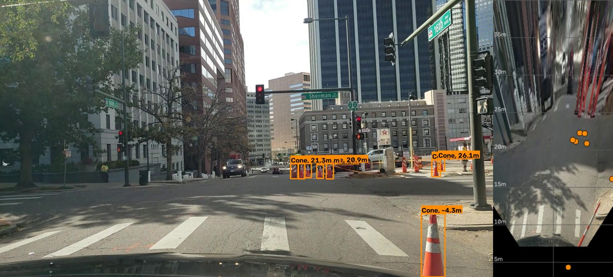
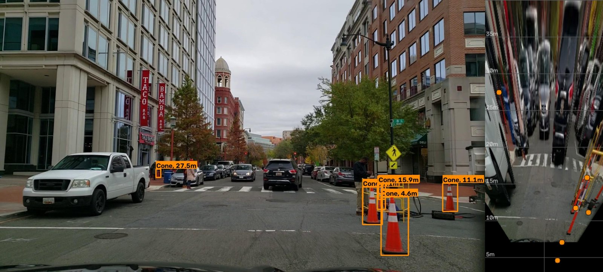
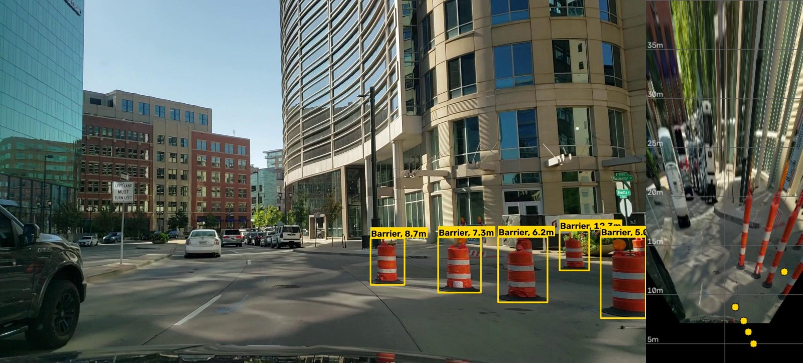
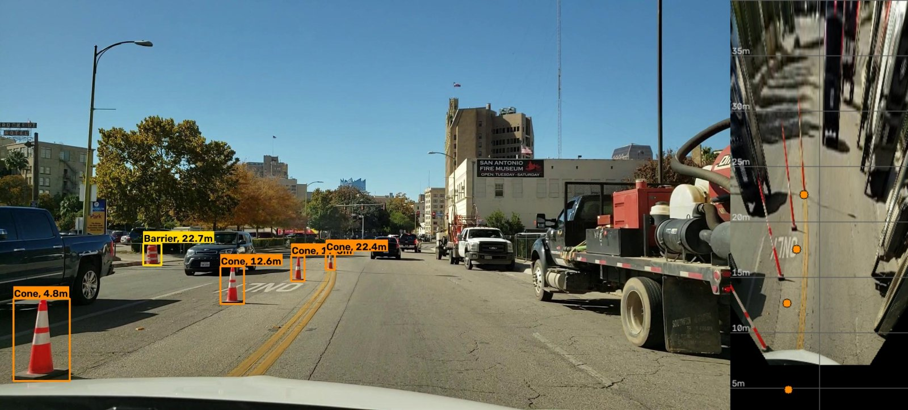
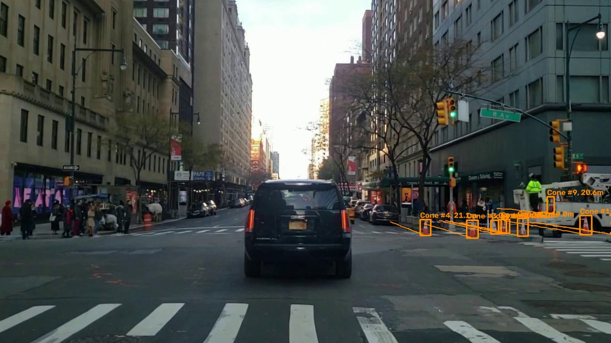

# Edge Object Distance Estimation

**Author:** Vivek Goud Cheruku · [vivekgoud.ch@gmail.com](mailto:vivekgoud.ch@gmail.com) · 8498060466 (see [Contact](#contact))

This project detects **cones, barriers and stop signs** in camera frames, estimates **how far away each one is** using camera geometry only, and makes the model **fast enough for edge hardware**. It was built as the ERIC Robotics take-home assignment.

```
camera frame ─► YOLO11n (fine-tuned, 3 classes) ─► pinhole / ground-plane geometry ─► "Cone, 1.5m"
```

> **Status (Nov 21, 2026):** everything below was trained, measured and checked on the target laptop. The numbers come from `results/` on that machine. The deeper statistics are in [docs/FINDINGS.md](docs/FINDINGS.md).

---

## 1. Problem and approach

A robot with a single camera needs to know *what* obstacles are ahead and *how far* they are, in real time, on limited hardware. The solution has three parts:

1. **Detection.** COCO-pretrained YOLO11n and YOLO11s are fine-tuned (transfer learning) to exactly 3 classes on public data.
2. **Distance.** No depth sensor and no learned depth are used. The distance comes from the pinhole camera model, the known real size of each object and the focal length. A second, independent method uses ground-plane geometry as a cross-check (see [docs/GEOMETRY.md](docs/GEOMETRY.md)). Labels look like `Cone, 1.5m`.
3. **Edge.** The models are exported to ONNX, ONNX FP16, OpenVINO FP32 and OpenVINO INT8, pruned, and swapped between nano and small backbones. All of them are timed on CPU and GPU with one benchmark script.

## 2. Results

Hardware: Intel i5-12450H (CPU), RTX 3050 Ti Laptop 4 GB (GPU), Ubuntu, Python 3.14. Test set: `data/merged_v2` test split, 486 images (417 ROADWork work-zone frames and 69 COCO stop-sign images). Nothing in it was trained on.

### 2.1 Detection: raw vs fine-tuned (`scripts/evaluate.py`)

| Model | mAP50 | mAP50-95 | AP50 cone | AP50 barrier | AP50 stop sign | Train time |
|---|---|---|---|---|---|---|
| YOLO11n raw (COCO, not fine-tuned) | 0.214 | 0.192 | 0 (no such class) | 0 (no such class) | 0.642 | – |
| **YOLO11n fine-tuned** | **0.789** | **0.534** | 0.762 | 0.762 | 0.843 | 42 min |
| YOLO11s fine-tuned | 0.829 | 0.568 | 0.804 | 0.813 | 0.869 | 57 min |

Context: ROADWork's own Mask R-CNN baseline reports 0.483 mAP50 over 15 classes. That isn't directly comparable.

**Data v1 to v2.** The first model (v1) trained on ROADWork cones and barriers plus an 18-image Roboflow barrier set. It reached test mAP50 0.576, but barrier AP50 was only 0.18, because ROADWork has just 611 barrier boxes and 3 crowded out-of-domain images dominated the barrier test set. v2 maps ROADWork's 5,499 **drums** to *barrier* and drops the 18-image set ([configs/data_sources_v2.yaml](configs/data_sources_v2.yaml)). Barrier AP50 rose to 0.76. On the 112 test images shared by both splits, cone AP50 (0.65 vs 0.62) and stop-sign AP50 (0.84 vs 0.85) are unchanged within noise, so the remap cost nothing elsewhere.

### 2.2 Edge optimisation: speed vs accuracy (`scripts/benchmark.py`)

Batch 1, 200 timed calls after 20 warm-up calls. Timing is end to end: pre-processing, inference, NMS and copying boxes back.

| Model | Format | Precision | Size MB | mAP50-95 | CPU ms (FPS) | GPU ms (FPS) |
|---|---|---|---|---|---|---|
| YOLO11n | PyTorch | FP32 | 5.5 | 0.534 | 32.4 (31) | 4.8 (210) |
| YOLO11n | ONNX | FP32 | 10.7 | 0.537 | 28.2 (35) | 6.4 (157) |
| YOLO11n | ONNX | FP16 | 5.4 | 0.534 | – | 5.0 (199) |
| YOLO11n | OpenVINO | FP32 | 10.8 | 0.537 | 26.2 (38) | – |
| **YOLO11n** | **OpenVINO** | **INT8** | **3.4** | **0.534** | **12.0 (83)** | – |
| YOLO11s | PyTorch | FP32 | 19.2 | 0.568 | 65.5 (15) | 7.4 (136) |
| YOLO11s | ONNX | FP16 | 19.0 | 0.567 | – | 7.5 (134) |
| YOLO11s | OpenVINO | FP32 | 38.1 | 0.570 | 71.5 (14) | – |
| **YOLO11s** | **OpenVINO** | **INT8** | **10.3** | **0.565** | **25.7 (39)** | – |

- **INT8 quantisation is the big CPU win.** It is 2.2× faster for YOLO11n and 2.8× for YOLO11s, costs 0.003–0.005 mAP50-95, and makes the file 3–4× smaller.
- **Backbone swap.** YOLO11s gains +0.034 mAP50-95 but is about 2.7× slower on CPU at the same precision. **YOLO11s INT8 runs as fast as YOLO11n FP32 (26 ms) and is more accurate (0.565 vs 0.537)**, so "bigger model plus INT8" beats "nano at FP32". With a 12 ms budget, YOLO11n INT8 is the pick.
- **Input size** (v1 model): at 416 or 320 px the model is 2–3× faster but loses 0.07–0.11 mAP50-95, because far cones vanish. INT8 at 640 is better than shrinking the input.
- **GPU:** YOLO11n is limited by per-call overhead, at 5–6 ms in any format. FP16 helps YOLO11s's ONNX path, cutting 11.1 ms to 7.5 ms.

**Pruning** (`scripts/prune.py`, L1 unstructured on every conv except the fixed DFL layer, no fine-tuning, v1 model):

| Sparsity | 0 % | 10 % | 20 % | 30 % | 50 % |
|---|---|---|---|---|---|
| mAP50-95 | 0.407 | 0.408 | 0.391 | 0.354 | 0.188 |
| GPU ms | 5.5 | 5.5 | 5.1 | 5.2 | 5.1 |

About 10–20 % of the weights are redundant. Zeros in dense kernels give **no speed-up and no smaller file**, so quantisation is the practical lever. Structured (channel) pruning followed by fine-tuning would be needed for real gains.

### 2.3 Distance

There is no dataset with distance labels for these objects, so the assumptions were tested statistically on the 18,500 labelled ROADWork boxes ([docs/FINDINGS.md](docs/FINDINGS.md)). The method uses log-space fits, bootstraps over whole images, a test per range band, and a Monte Carlo error budget. The main results:

| Error source | Size | Verdict |
|---|---|---|
| Detector box height, boxes ≥ 32 px | bias < 1 %, noise 1.5–7.5 % | negligible |
| Detector, boxes of 16–32 px | bias −4.6 %, recall 41 % | usable range for cones ≈ 20 m |
| Real object-height spread (cones) | ×/÷ 1.45 per box (log sd 0.38–0.46) | **the error floor** |
| Focal length (±10 % → calibrated ±2 %) | ×/÷ 1.61 → 1.55 overall | small |
| Camera mount (the 1080p data pools 18 city fleets) | horizon from 44 % to 64 % of image height | calibrate per robot |

The pinhole and ground-plane estimates disagreed by 2× with the generic dashcam profile. A profile **fitted from the labels**, `roadwork_1080p` in [configs/camera.yaml](configs/camera.yaml), brings the median pinhole/ground ratio on 1080p frames from 1.89 to 0.97. The share of detections where the two agree well enough to fuse rises from 20 % to 59 %. Objects nearer than about 9 m still fall back to pinhole, because the fitted horizon is an average over fleets and the bottom rows sit near the hood. The phone photos are a different camera (ratio 1.65). The reported uncertainty now uses the measured height spread (±40 %) instead of a guess (±25 %).

A real robot needs `scripts/calibrate_camera.py` (focal length) plus `scripts/validate_distance.py` (cones at taped distances), which measures the end-to-end error directly.

### 2.4 Sample outputs

YOLO11n v2 with `--camera roadwork_1080p --method fused --bev`. The labels follow the brief's format, and `~` marks an estimate flagged as unreliable.

| | |
|---|---|
|  |  |
|  |  |

Optical-flow tracking (`scripts/track.py`) follows each cone with an id and a trail. Corner-only boxes mark frames where the detector missed and the optical flow carried the box:



### 2.5 Extra credit

- **Homography / bird's-eye view:** `--bev` warps the ground plane to a top-down map using a homography built from 4 projected ground points ([docs/GEOMETRY.md §5](docs/GEOMETRY.md)).
- **Epipolar geometry:** the derivation of `Z = f·B/d`, depth resolution `ΔZ = Z²/(f·B)·Δd`, and a comparison with mono error. It also derives **motion stereo** with one camera, `Z₂ = B·h₁/(h₂ − h₁)`, which needs neither the focal length nor the object height ([§6](docs/GEOMETRY.md), checked numerically in `tests/test_stereo.py`).
- **Optical flow:** `src/tracking.py` uses pyramidal Lucas–Kanade with a forward-backward check. The box moves by the median feature shift and scales by the median ratio of pairwise distances. Tracks are matched to detections by IoU, can coast through up to 5 missed frames, and get log-space distance smoothing. ROADWork frames are at least 1 s apart (sampled from video), which is too far apart for flow, so the demo uses a simulated forward-motion clip (`--simulate`). On it, flow carried 17 % of the track-frames where the detector missed, with 12 ids for about 8 cones, so a few id switches remain. On real video the script runs as is.

## 3. Dataset

**BDD100K, the dataset suggested in the brief, does not contain the target classes.** Its 10 detection classes are pedestrian, rider, car, truck, bus, train, motorcycle, bicycle, traffic light and traffic sign. It has no cone or barrier class, and stop signs are merged into the generic "traffic sign". The brief marks the dataset as optional, so the training data is assembled from public sources instead. Each source is remapped to our 3 classes ([configs/data_sources.yaml](configs/data_sources.yaml)):

| Source | Gives | Classes kept → ours | License |
|---|---|---|---|
| [ROADWork](https://www.cs.cmu.edu/~roadwork/) (CMU, ICCV 2025), via its [Roboflow export](https://universe.roboflow.com/roadworkwithdirectionalpanelsallobjects/roadwork_vpanels_all_objects) | Cones and barriers in real US work zones, seen from a car | Cone → cone; Barrier and (v2) Drum → barrier. Dropped: Tubular Marker, Vertical Panel | CC BY 4.0 |
| [barrier_detection](https://universe.roboflow.com/bhornphawis-jungbunjerdsak-y3rsf/barrier_detection) (Roboflow), v1 only | More Jersey/concrete and water-filled barriers (18 images; dropped in v2) | concrete_barrier, water_barrier → barrier; traffic_cone → cone | CC BY 4.0 |
| [COCO 2017](https://cocodataset.org) | Stop signs (category 13), plus 300 background images | stop sign → stop_sign | CC BY 4.0 (annotations) |

**Class definitions.**
- **Cone:** a traffic cone.
- **Barrier:** anything that blocks the lane as a solid object: Jersey/concrete or water-filled barriers, barricades and (v2) channelizer drums. Type III striped barricades and vertical panels are *not* included, so the model misses them.
- **Stop sign:** the octagonal sign plate only, without the pole.

**Splits.** Each source's own train/val/test split is kept, to avoid leaking Roboflow's augmented copies into the test set. ROADWork's export is train-only, so for sources like it, 10% val and 10% test are carved out of train in *groups*. A group is one original image together with its augmented copies, or one whole sequence when `group_regex` is set, so near-duplicate frames never end up in both train and test. COCO train2017 is split 85/15 into our train and val, and COCO val2017 becomes our test set. `test_<source>.txt` gives a per-source test slice.

**Known label noise.** Unlabelled cones may appear in COCO images, and unlabelled stop signs in ROADWork images. Merging datasets that were labelled for different class sets always has this problem.

## 4. Distance estimation

| | Pinhole, known height (main) | Ground plane (cross-check) |
|---|---|---|
| Formula | `Z = f · H / h_box` | `Z = f · h_cam / (y_bottom − y_horizon)` |
| Needs | Real object height H | Camera height and pitch; flat ground |
| Works for | All classes | Cone and barrier (not stop signs on poles) |
| Main error source | H varies between objects (cones are 0.45 to 0.91 m) | Road slope, camera pitch |

**Assumptions** ([configs/camera.yaml](configs/camera.yaml)):
- Generic dashcam profile `bdd100k`: f ≈ 1005 px (an assumed 65° horizontal field of view at 1280 px, because BDD publishes no intrinsics), camera height 1.3 m.
- `roadwork_1080p` profile: camera height and horizon fitted from ROADWork labels (§2.3), f ≈ 1507 px (65° at 1920 px).
- Object heights: cone 0.70 m, barrier 0.80 m, stop sign 0.75 m. Relative uncertainty is ±40 % for cone and barrier (measured), and ±15 % for stop signs (a standard size).
- For validation, a phone camera calibrated with a checkerboard (`scripts/calibrate_camera.py`).

**Reliability.**
- Boxes cut by the image border, tiny boxes and clamped values are flagged, and their label is shown as `Cone, ~14.0m`.
- Every estimate carries a first-order uncertainty: `ΔZ/Z = sqrt((ΔH/H)² + (Δf/f)² + (Δh/h)²)`.
- `scripts/validate_distance.py --sensitivity` prints the full error table.

## 5. Edge optimisation

| Technique | Implemented as | Effect |
|---|---|---|
| ONNX export | `export.py --variants onnx` | Portable graph that runs on ONNX Runtime CPU or CUDA |
| FP16 | `onnx_fp16`, `engine_fp16` | About half the size and faster on GPU tensor cores; tiny accuracy change |
| INT8 post-training quantisation | `openvino_int8` (NNCF, calibrated on our images) | About 4× smaller, faster on CPU; small mAP drop |
| Smaller input | `--imgsz 640 416 320` | Large speed-up; hurts small, distant objects most |
| Lighter or heavier backbone | YOLO11n vs YOLO11s | Trade between accuracy and speed |
| Pruning (L1 unstructured) | `scripts/prune.py` | Measured: no loss up to 10 %, −4 % mAP at 20 %, cliff at 50 %, **no speed-up** with dense kernels |

TensorRT has no Python 3.14 build yet, so the GPU FP16 row uses ONNX Runtime CUDA (see [docs/SETUP.md](docs/SETUP.md)).

## 6. How to run

```bash
# 0. environment (see docs/SETUP.md). If ROS is sourced, prefix commands with: env -u PYTHONPATH
python3 -m venv .venv && source .venv/bin/activate
pip install -r requirements.txt        # exact pins (or: uv pip install -r requirements.txt)
#   uv users: `uv sync` also works now (deps are listed in pyproject.toml)
export ROBOFLOW_API_KEY=...            # free account, Settings → API key

# 1. data: download, remap, merge, split; then LOOK at it
python -m scripts.prepare_data --config configs/data_sources_v2.yaml   # v2 mix -> data/merged_v2
python -m scripts.review_data --data data/merged_v2                    # results/data_review/*_grid.jpg

# 2. train (sanity run first, then the real one)
python -m scripts.train --model yolo11n --smoke --set data=data/merged_v2/data.yaml
python -m scripts.train --model yolo11n --set data=data/merged_v2/data.yaml name=yolo11n_v2
python -m scripts.train --model yolo11s --set data=data/merged_v2/data.yaml name=yolo11s_v2

# 3. raw vs fine-tuned
python -m scripts.evaluate --data data/merged_v2 --models raw=yolo11n.pt \
    n_v2=runs/detect/yolo11n_v2/weights/best.pt s_v2=runs/detect/yolo11s_v2/weights/best.pt

# 4. export + benchmark
python -m scripts.export --weights runs/detect/yolo11n_v2/weights/best.pt --imgsz 640 --data data/merged_v2/data.yaml
python -m scripts.benchmark --images data/merged_v2/images/test   # each OpenVINO model runs in its own process
python -m scripts.prune --weights runs/detect/yolo11n_v2/weights/best.pt --amounts 0.1 0.2 0.3 0.5

# 5. demo
python -m scripts.infer --weights runs/detect/yolo11n_v2/weights/best.pt --source path/to/images_or_video \
    --camera roadwork_1080p --method fused --bev
python -m scripts.track --weights runs/detect/yolo11n_v2/weights/best.pt --source drive.mp4   # or --simulate still.jpg

# 6. distance: assumption tests on labels, then validation on your own camera
python -m scripts.distance_analysis --weights runs/detect/yolo11n_v2/weights/best.pt
python -m scripts.validate_distance --sensitivity
python -m scripts.calibrate_camera --images data/calib --pattern 9 6 --square-mm 25
python -m scripts.validate_distance --weights runs/detect/yolo11n_ft/weights/best.pt \
    --camera my_camera --csv data/distance_photos/ground_truth.csv

# tests, and a full dry run without downloads
python -m pytest
python -m scripts.make_synthetic_data && python -m scripts.prepare_data --config tests/data_sources_synthetic.yaml
```

## 7. Repository layout

```
configs/      camera.yaml (geometry assumptions), data_sources(_v2).yaml, train.yaml
src/          library: classes, config, types, detector, distance, distance_analysis, visualize, bev,
              tracking (optical flow), stereo, evaluation, timing, reporting
src/data/     yolo_labels (I/O + remap), roboflow, coco, merge, stats
scripts/      prepare_data, review_data, train, evaluate, export, benchmark, infer, track,
              prune, distance_analysis, calibrate_camera, validate_distance, make_synthetic_data
tests/        unit tests + synthetic-data config
docs/         FINDINGS (statistics), GEOMETRY (derivations), MODULES (code walkthrough), ARCHITECTURE,
              PLAN, PACKAGES, SETUP; images/ (README figures)
results/      tables, plots, sample outputs (committed)
data/, runs/, models/   datasets, training runs, exports (git-ignored)
```

## 8. Limitations and next steps

- **Distance error is dominated by real object size** (×/÷ 1.45 per box), not by the detector. Classifying the cone type (45, 70 or 91 cm), keypoints plus PnP (Dhall et al. 2019 report about 5 % error), or motion stereo from odometry (§2.5) would each cut it.
- **No ground-truth distances.** The error budget is inferred from label geometry and Monte Carlo. One session with taped distances (`validate_distance.py`) would measure it directly.
- **Camera model:** the `roadwork_1080p` profile averages 18 dash-cam fleets. A deployed robot must use its own calibration. The ground-plane method also assumes flat road.
- **Classes:** Type III barricades and vertical panels are not in the barrier class and are missed. Small (< 16 px) objects are rarely detected, at 4 % recall.
- **Label noise from merged datasets:** COCO images may contain unlabelled cones, and ROADWork images unlabelled stop signs. Pseudo-labelling is the next step.
- **Tracking** was only demonstrated on a simulated clip. It still shows a few id switches in clutter.
- **Laptop quirks:** OpenVINO's NPU plugin segfaults when a second model loads in one process (worked around), and TensorRT has no Python 3.14 build.

## 9. Credits

- [Ultralytics YOLO](https://github.com/ultralytics/ultralytics) (AGPL-3.0).
- Datasets: ROADWork (Ghosh et al., ICCV 2025), Roboflow Universe contributors, COCO (Lin et al., 2014).
- Geometry references: Dhall, Dai and Van Gool, "Real-time 3D Traffic Cone Detection for Autonomous Driving" (2019).
- Code: MIT, see [LICENSE](LICENSE). Ultralytics is AGPL-3.0, so anyone who redistributes this code together with Ultralytics is bound by the AGPL for the combined work.

## Contact

| | |
|---|---|
| **Name** | Vivek Goud Cheruku |
| **Phone** | 8498060466 |
| **Email** | [vivekgoud.ch@gmail.com](mailto:vivekgoud.ch@gmail.com) |
