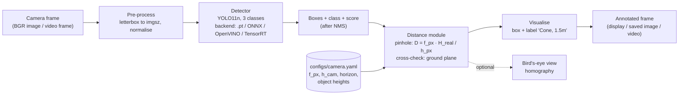
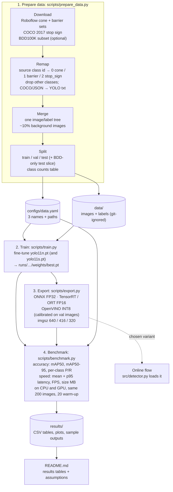

# Architecture

This project has two flows that share one model artefact:

- **Online flow (runtime):** what runs on the robot for every camera frame.
- **Offline flow (build-time):** what produces, compresses and measures the model that the online flow uses.

Stage-to-file mapping follows [PLAN.md §7](PLAN.md#7-repo-structure). The files listed below don't exist yet. They are the planned locations.

---

## 1. Online flow: camera frame → annotated frame

| Stage | What it does | Lives in |
|---|---|---|
| Frame input | Reads an image, video or camera stream, one frame at a time | `scripts/infer.py` |
| Pre-process + detector | Hides every backend (PyTorch, ONNX Runtime, OpenVINO, TensorRT) behind one `predict()` that returns boxes, classes and scores | `src/detector.py` |
| Distance module | Pinhole distance from box height and known object height; ground-plane distance from the box's bottom edge and camera height; flags for boxes cut by the border, tiny boxes and clamped values | `src/distance.py` |
| Camera / object parameters | Focal length in pixels, camera height, horizon row, real height per class | `configs/camera.yaml` |
| Visualise | Draws boxes and labels in the exact `Cone, 1.5m` format | `src/visualize.py` |
| Bird's-eye view (optional) | Top-down plot of detections via `cv2.getPerspectiveTransform` | `src/bev.py` |
| Output | Saves annotated images/videos for the README | `results/` |

Class ids used everywhere: `0 cone`, `1 barrier`, `2 stop_sign`.

---

## 2. Offline flow: data → train → export → benchmark

| Stage | Steps | Lives in | Inputs → outputs |
|---|---|---|---|
| 1. Prepare data | Download, remap, merge, split | `scripts/prepare_data.py` | Public datasets → `data/` tree, `configs/data.yaml`, class-count table |
| 2. Train | Sanity run (3 epochs on 10% of the data), then full fine-tune; n and s models | `scripts/train.py` (optional Colab copy in `notebooks/`) | `configs/data.yaml` + `yolo11n.pt` → `runs/detect/<name>/weights/best.pt` |
| 3. Export | ONNX FP32, FP16 (TensorRT engine or ORT CUDA), INT8 (OpenVINO with calibration data), smaller `imgsz` | `scripts/export.py` | `best.pt` → `*.onnx`, `*.engine`, `*_openvino_model/` (all git-ignored) |
| 4. Benchmark | Same script and same val/test images for every variant; accuracy plus CPU/GPU latency | `scripts/benchmark.py` | Every model variant → `results/*.csv`, plots |
| Report | Results tables, sample images, limitations | `README.md` | `results/` → README |

---

## 3. Where shared pieces live

| Piece | Location | Used by |
|---|---|---|
| Dataset definition | `configs/data.yaml` | train, benchmark (accuracy) |
| Camera + object heights | `configs/camera.yaml` | `src/distance.py`, `scripts/infer.py` |
| Backend wrapper | `src/detector.py` | `scripts/infer.py`, `scripts/benchmark.py` (the same code is timed and shipped) |
| Raw and merged datasets | `data/` | git-ignored |
| Training runs and weights | `runs/` | git-ignored; `best.pt` for the nano model (≈6 MB) may be committed or linked |
| Tables, plots, sample frames | `results/` | committed |

## 4. Design notes

- **Online and offline share `src/detector.py`.** The benchmark times the same code path that `infer.py` ships, so the FPS numbers describe the real pipeline, not a separate harness.
- **The distance module is backend-agnostic.** It only needs `(class, box)` and `camera.yaml`, so every export variant gets distances for free.
- **All assumptions live in configs** (focal length, camera height, object heights). The README sensitivity analysis changes these values, not the code.
